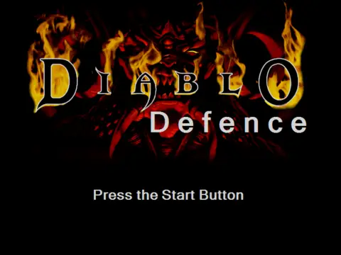
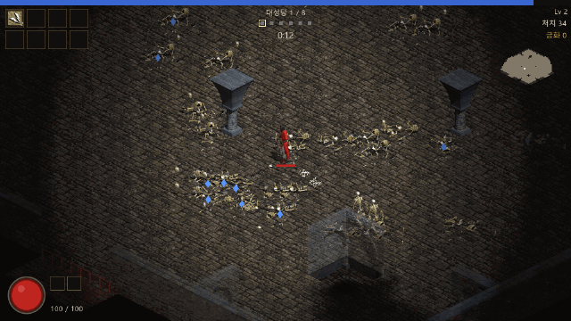

# Diablo Defence Remastered

2011년에 C# WinForms 로 만든 개인 프로젝트 "DiabloDefence" 를 새로 설계해 다시 만드는 프로젝트.
디아블로 1 분위기의 안뜰에서 몰려오는 해골·좀비·염소인간을 버티는, 뱀파이어 서바이버즈 방식의 생존 액션으로 바꾼다.

## 원작 (2011)



원작 코드를 그대로 돌려 녹화한 화면이다. 클릭으로 이동하고, 우클릭으로 매직 미사일·파이어볼을 쏜다.

## 리마스터 (진행 중, 2026-11-11)



단계 1 판을 자동 조작(`--autoplay --seed 7`)으로 돌려 액트 1 첫 방 50~58초를 0.1초마다 찍어 묶은 화면이다(960×540 → 640×360).
무기가 저절로 나가고, 쓰러진 해골이 경험치 보석(파란 마름모)을 떨군다.

## 리마스터에서 바꾸는 것

- **장르**: 이동 위주 조작 + 자동 공격, 레벨업 때 강화 선택, 생존 시간
- **엔진**: WinForms + GDI+ → .NET 9 + MonoGame (고정 틱 시뮬레이션, 보간 렌더, GPU 스프라이트 배치)
- **이동·길찾기**: 정수 픽셀·틱 단위 이동 → 실수 좌표·초당 속도. 무리는 플로우 필드, 보스·정예는 A*
- **맵**: 충돌 정보가 없던 맵에 배경과 어울리는 벽·장애물을 그려 넣고, 같은 정의로 길찾기 격자를 만든다
- **구조**: 유닛 종류마다 if/else 로 복사하던 코드 → 데이터 정의(적·무기·패시브·스테이지)를 더하면 늘어나는 구조
- **몬스터**: 기존 그림 5벌에 색·크기·행동 변형을 더해 10종 이상

## 진행 상황

기획·설계 단계. 기획·설계·구현·검증 네 역할이 서로 리뷰하며 만든다.

| 문서 | 내용 |
|---|---|
| [docs/brief.md](docs/brief.md) | 요구사항, 원작 분석, 그림 자원 표 |
| docs/gdd.md | 기획서 (작성 중) |
| docs/architecture.md | 설계서 (작성 중) |

## 그림·소리 자원

디아블로 1 그림·소리는 Blizzard Entertainment 의 저작물이라 이 저장소에 넣지 않는다(가져온 결과도 `.gitignore` 로 막는다).
원작 디아블로 1 의 `diabdat.mpq` 와 원작 DiabloDefence 실행 파일을 가지고 있으면, 클론한 뒤 한 번 아래 명령으로 `src/DiabloDefenceRemastered/Assets/` 를 채운다.
원본 파일은 읽기만 한다.

```powershell
powershell -ExecutionPolicy Bypass -File tools\import-all.ps1 -Diabdat "<디아블로 폴더>\diabdat.mpq" -Exe "<원작 경로>\bin\Debug\DiabloDefence.exe"
```

- 원작 exe 그림(`tools\import-assets.ps1`)을 먼저, 그다음 `diabdat.mpq`(`tools\DiabloAssetImporter`)를 가져온다. 두 번째 실행부터는 캐시로 빨리 끝난다.
- 헬파이어 MPQ(`hellfire.mpq`·`hfmonk.mpq`·`hfmusic.mpq`·`hfvoice.mpq`)는 `diabdat.mpq` 와 같은 폴더에 있으면 저절로 쓴다. 없으면 그 내용만 꺼진다.
  다른 폴더면 `-Hellfire "<폴더>"`, 헬파이어 없이 가져오려면 `-SkipBundles all`.
- 자세한 옵션·종료 코드는 `docs/architecture.md` 1.4.
- 빛 셰이더는 빌드 때 저장소 로컬 도구 `dotnet-mgfxc`(`.config/dotnet-tools.json`)로 컴파일한다. 첫 빌드가 `dotnet tool restore` 로 받아 온다(Windows).

### AI 확대(선택)

`-Upscale realesrgan-x4plus` 를 주면 맵 그림과 큰 몬스터를 [Real-ESRGAN](https://github.com/xinntao/Real-ESRGAN) ncnn-vulkan 으로 확대한 그림으로 가져온다(기본은 끔 — 원본 픽셀).
가져오기 도구는 이 프로그램을 내려받지 않는다. 쓰려면 직접 받는다.

- 받는 곳: Real-ESRGAN 의 GitHub 릴리스 **v0.2.5.0** 의 Windows 판 `realesrgan-ncnn-vulkan-20220424-windows.zip`(BSD-3-Clause). 도구는 이 판의 파일 해시만 받아들인다.
- 풀 곳: `%LOCALAPPDATA%\DiabloDefenceRemastered\realesrgan-ncnn-vulkan\`(기본값, 저장소 밖). 다른 폴더면 `-UpscaleBin "<폴더>"`.
  `dotnet run --project tools/DiabloAssetImporter -- upscaler-check` 로 해시·Vulkan 런타임·GPU 를 먼저 확인할 수 있다.
- 확대를 못 하면(파일 없음·해시 다름·Vulkan 런타임 없음·실패) 원본 픽셀로 가져오고 경고를 보인다.
- 이 프로그램은 저장소·`Assets`·가져온 결과 어디에도 들어가지 않고 배포하지 않는다.

## 제3자 고지

| 구성 요소 | 쓰는 곳 | 라이선스 |
|---|---|---|
| [MonoGame](https://github.com/MonoGame/MonoGame) `MonoGame.Framework.DesktopGL` | 게임 | Ms-PL |
| [FontStashSharp](https://github.com/FontStashSharp/FontStashSharp) | 게임 | Zlib |
| [War3Net](https://github.com/Drake53/War3Net) `War3Net.IO.Mpq`(`War3Net.IO.Compression`·`War3Net.Common` 포함)·[SharpZipLib](https://github.com/icsharpcode/SharpZipLib) | 가져오기 도구(MPQ 읽기) | MIT |

Real-ESRGAN ncnn-vulkan(BSD-3-Clause)은 사용자가 따로 받아 쓰는 선택 프로그램이라 이 저장소에 들어 있지 않다.
