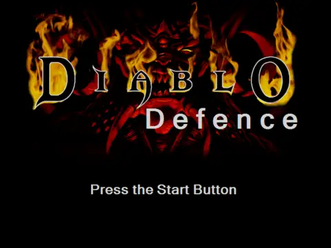

# Diablo Defence Remastered

2011년에 C# WinForms 로 만든 개인 프로젝트 "DiabloDefence" 를 새로 설계해 다시 만드는 프로젝트.
디아블로 1 분위기의 안뜰에서 몰려오는 해골·좀비·염소인간을 버티는, 뱀파이어 서바이버즈 방식의 생존 액션으로 바꾼다.

## 원작 (2011)



원작 코드를 그대로 돌려 녹화한 화면이다. 클릭으로 이동하고, 우클릭으로 매직 미사일·파이어볼을 쏜다.

## 리마스터에서 바꾸는 것

- **장르**: 이동 위주 조작 + 자동 공격, 레벨업 때 강화 선택, 생존 시간
- **엔진**: WinForms + GDI+ → .NET 9 + MonoGame (고정 틱 시뮬레이션, 보간 렌더, GPU 스프라이트 배치)
- **이동·길찾기**: 정수 픽셀·틱 단위 이동 → 실수 좌표·초당 속도. 무리는 플로우 필드, 보스·정예는 A*
- **맵**: 충돌 정보가 없던 맵에 배경과 어울리는 벽·장애물을 그려 넣고, 같은 정의로 길찾기 격자를 만든다
- **구조**: 유닛 종류마다 if/else 로 복사하던 코드 → 데이터 정의(적·무기·패시브·스테이지)를 더하면 늘어나는 구조
- **몬스터**: 기존 그림 5벌에 색·크기·행동 변형을 더해 10종 이상

## 진행 상황

기획·설계 단계. 기획·설계·구현·검증 네 역할이 서로 리뷰하며 만든다.

| 문서 | 내용 |
|---|---|
| [docs/brief.md](docs/brief.md) | 요구사항, 원작 분석, 그림 자원 표 |
| docs/gdd.md | 기획서 (작성 중) |
| docs/architecture.md | 설계서 (작성 중) |

## 그림 자원

디아블로 1 그림 자원은 Blizzard Entertainment 의 저작물이라 이 저장소에 넣지 않는다.
원작 DiabloDefence 실행 파일을 가지고 있으면 아래 스크립트로 꺼내 `src/DiabloDefenceRemastered/Assets/` 를 채운다.

```powershell
powershell -ExecutionPolicy Bypass -File tools\import-assets.ps1 -Source "<원작 경로>\bin\Debug\DiabloDefence.exe"
```
